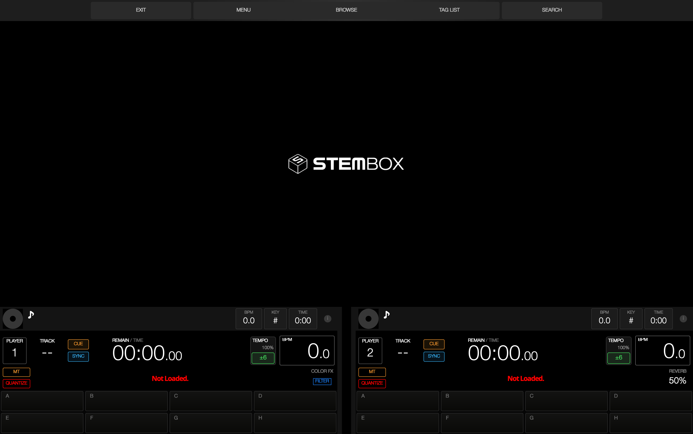

# Stemboks

A clean-room clone of **Stembox 1.8.9** — the CDJ-style stem DJ player —
reverse engineered from the installed macOS app with REA (see
[docs/rea/](docs/rea/)) and rebuilt as a native Qt 6 / C++ application.



## What it does

- 4 decks (2 visible CDJ bars, Large/Split layouts), giant scrolling
  waveforms (BLUE / RGB / 3BAND), beatgrid, key (Camelot) display.
- Real-time stems: play any track as **drums / bass / other / vocals**
  with per-stem mute and gain pads. Loads pre-separated stems
  (`.stem.mp4` or sidecar `<name>.stems/` folder) and can separate new
  tracks with an HTDemucs ONNX model (`stems-hdemucs-mmi-v1.onnx`) when
  ONNX Runtime is available.
- CDJ workflow: hotcues A–H, beat loops, beatjump, slip, reverse slip,
  quantize, sync, master tempo (keylock), key shift, tempo ranges
  ±6/10/16/100, vinyl brake/backspin.
- Mixer: 3-band EQ (ISO/EQ), Color FX (filter, space, dub echo, crush,
  pitch, noise), Beat FX + Pad FX (roll, echo, vinyl brake, reverb,
  enigma jet, phaser, flanger, trans…), crossfader curves, 8-band master
  EQ, auto gain, limiter, headphone cueing on a second output.
- Library like the original: SOURCE screen for USB sticks, drill-down
  browse (Playlist / Artist / Album / Key / Folder / History / Matching),
  full-screen search with on-screen QWERTY/AZERTY keyboard, Tag List,
  SQLite database, waveform/LUFS caches, TSV hotcue/grid sidecars.
- Sampler (8 slots) + Drum Station kits, mix recording (WAV/MP3,
  16/24/32-float), second-screen CDJ display, dark/light themes,
  60 fps UI, interface scaling.
- Controllers: MIDI + HID with Stembox's own `SBX_CONTROLLER_MAPPING 6`
  text format. Ships mappings for Pioneer **DDJ-400, DDJ-800, DDJ-1000,
  DDJ-FLX4, DDJ-FLX6, DDJ-FLX10, DDJ-GRV6**.

## Platforms

macOS (Apple Silicon/Intel), Windows x64, Linux x86-64, **Linux ARM64**.
CI builds all four on every push (see Actions artifacts).

## Build

Dependencies: Qt 6 (Widgets/Sql/Svg/Network/Concurrent), FFmpeg
(libavformat/codec/util/swresample), hidapi. RtMidi is fetched by CMake.
ONNX Runtime is optional (stem separation).

```sh
# macOS
brew install qt ffmpeg hidapi pkg-config
cmake -S . -B build -DCMAKE_PREFIX_PATH="$(brew --prefix qt);$(brew --prefix)"
cmake --build build -j
open build/stemboks.app

# Linux (x86-64 and ARM64 alike)
sudo apt install qt6-base-dev qt6-svg-dev libqt6sql6-sqlite \
  libavformat-dev libavcodec-dev libavutil-dev libswresample-dev \
  libhidapi-dev libasound2-dev libpulse-dev pkg-config
cmake -S . -B build && cmake --build build -j
./build/stemboks

# Windows: use MSYS2 MINGW64 with the packages in .github/workflows/build.yml
```

## Using stems

Put separated stems next to a track as `<track>.stems/drums.wav`,
`bass.wav`, `other.wav`, `vocals.wav`, or play a Native Instruments
`.stem.mp4`. To separate inside the app, open **BROWSE → STEMS MANAGER**,
point it at an HTDemucs ONNX model, and queue tracks.

## Data locations

Same layout as the original, under the platform app-data dir `stemboks/`:
`library.db`, `usersettings.json` (same JSON shape), `mappings/`,
`cache/ondes/*.onde`, `cache/sonie/*.lufs`, `hotcues-locaux.tsv`,
`grilles-locales.tsv`, `historique/`.

## Reverse-engineering notes

Everything in `docs/rea/` is evidence gathered from the installed app:
binary inventory, UI inventory (28 skin templates + QSS), controller
mapping format and control registry, database schema, and live
screenshots of every screen. The code here is an original implementation
of that observed behavior — no Stembox/Mixxx code or assets are included,
except factual hardware MIDI numbers and the openly documented formats.

## License

GPL-3.0-or-later. OpenSans fonts: SIL OFL 1.1. miniaudio: public
domain/MIT-0. RtMidi: MIT-like. FFmpeg/Qt/hidapi under their own licenses.
